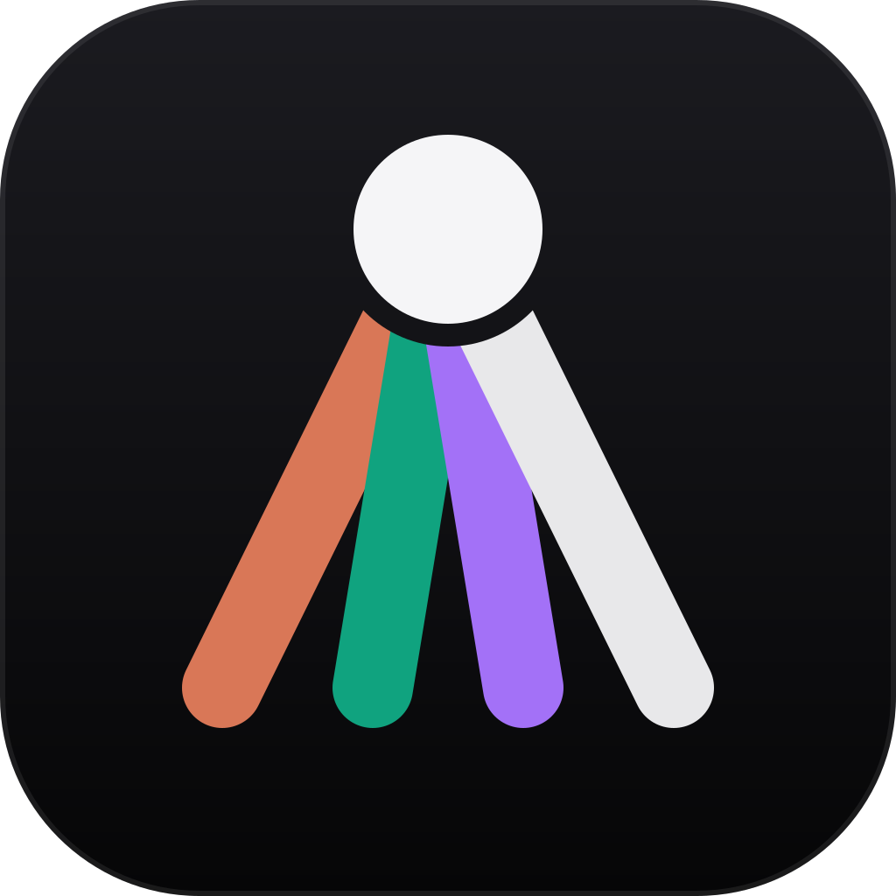

<p align="center"></p>
<h1 align="center">Agentia</h1>
<p align="center"><b>Dirige a todas tus IAs. Sin comerte la RAM.</b><br>
Corre Claude Code, Codex, Copilot CLI y OpenCode en paralelo, cada uno en su propia rama.</p>

---

## ¿Qué es?

Agentia es una app de escritorio (Windows, Mac y Linux) para trabajar con **varios agentes de IA a la vez** sin que se pisen:
cada tarea tiene su propia rama de git (*worktree*), su propia terminal y su propio agente. Tú solo diriges.

**Sin API keys.** Agentia abre los programas oficiales (`claude`, `codex`, `copilot`, `opencode`), que usan la sesión que ya tienes iniciada. Tus llaves nunca pasan por la app.

## Lo que hace

- **Tareas en paralelo**: nueva tarea → rama + carpeta propia + el agente que elijas (copia tu `.env` si quieres).
- **Terminal integrada** con el agente, y terminales extra por tarea (`npm run dev`, etc.).
- **Estados en vivo**: trabajando · te necesita · listo · dormido, sin configurar nada.
- **Bandeja "Te necesita"**: contesta Sí / No a los permisos sin abrir la terminal. Avisos de escritorio.
- **Progreso y actividad**: la lista de pasos del agente y lo que va leyendo, editando y ejecutando.
- **Cambios**: diff por archivo, commit, descartar, push y **Pull Request** (con GitHub CLI).
- **Tablero** tipo kanban: Por hacer · Trabajando · En revisión · Hecho.
- **Agentes que se duermen**: un agente que terminó y no usas se duerme para liberar RAM; despierta con un click y sigue su conversación.
- **Uso de tus planes**: cuánto llevas de tus límites de Claude, Codex y Antigravity.
- **Importa tus proyectos de Orca** automáticamente.
- 4 temas: Grafito, Medianoche, Negro y Claro.

## Instalar

Descarga el instalador de la [última versión](../../releases/latest):

| Sistema | Archivo |
|---|---|
| Windows | `Agentia_x.y.z_x64-setup.exe` o `.msi` |
| Mac (Apple Silicon / Intel) | `Agentia_x.y.z_aarch64.dmg` / `_x64.dmg` |
| Linux | `.AppImage` (cualquier distro), `.deb` (Ubuntu/Debian) o `.rpm` (Fedora) |

> **Mac:** la app no está firmada todavía. La primera vez: clic derecho sobre Agentia → **Abrir** → Abrir.
> **Windows:** si aparece "Windows protegió tu PC": **Más información → Ejecutar de todas formas**.

### Necesitas tener

- **git**
- Al menos un agente instalado y con sesión iniciada: [Claude Code](https://docs.anthropic.com/claude-code), [Codex](https://github.com/openai/codex), [Copilot CLI](https://github.com/github/copilot-cli) u [OpenCode](https://opencode.ai)
- Opcional: [GitHub CLI](https://cli.github.com) (`gh auth login`) para crear Pull Requests desde la app

## Uso rápido

1. **Ajustes → Agregar proyecto** y elige la carpeta de un repositorio git (o se importan solos desde Orca).
2. **Nueva tarea** (`Ctrl N`): proyecto, nombre, agente e instrucciones → **Crear y arrancar**.
3. Mientras trabaja, revisa **Progreso** y **Actividad**; si te pide permiso, contéstale desde la bandeja.
4. En **Cambios** revisa el diff, haz **Commit** y **Crear PR**.

| Atajo | Acción |
|---|---|
| `Ctrl N` | Nueva tarea |
| `Ctrl K` | Buscar |
| Doble click en el título | Renombrar tarea |

## Privacidad

- No hay telemetría ni cuentas.
- Todo se guarda en tu compu (`~/.config/agentia/`).
- Para mostrar tu uso, la app consulta **solo** las APIs oficiales de cada proveedor con tu sesión ya iniciada.

## Desarrollo

```bash
npm install
npm run tauri dev      # modo desarrollo
npm run tauri build    # instalador para tu sistema
```

Los instaladores de las 3 plataformas se generan con GitHub Actions al publicar una etiqueta (`git tag v1.0.0 && git push --tags`).

Hecho con [Tauri](https://tauri.app) + [Svelte](https://svelte.dev) + [xterm.js](https://xtermjs.org).
Inspirado en [Orca](https://github.com/stablyai/orca) (MIT). Logos de agentes: [Lobe Icons](https://github.com/lobehub/lobe-icons) (MIT) y [Simple Icons](https://simpleicons.org) (CC0); las marcas pertenecen a sus dueños.

---
Hecho en México 🇲🇽 por **Codefy**.
